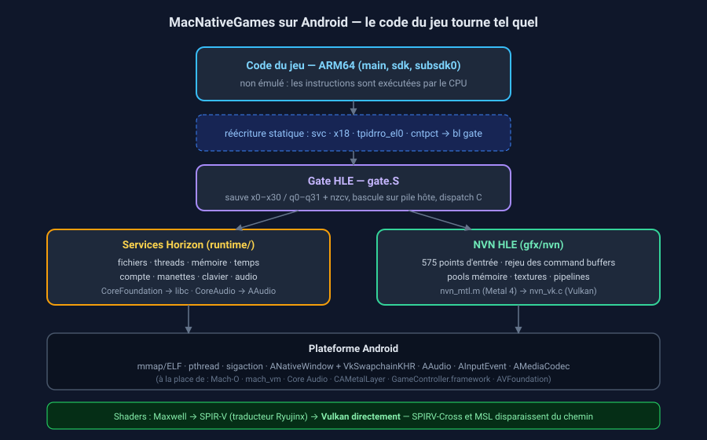

# MacNativeGames — portage Android

Ce dépôt est le point de départ d'un portage **Android** de
[MacNativeGames](https://github.com/ly05010419/MacNativeGames) (TOTK recompilé
nativement pour Apple silicon, et non émulé).

> **État : squelette fonctionnel, pas encore un jeu jouable.**
> **Testé sur un appareil réel** (Redmi 23090RA98G, Mali-G610 MC4, Android 16) :
> ~120 fps, rendu correct, cycle arrière-plan/premier plan OK.
> Ce qui marche ici : la chaîne de build Android complète (NDK → `.so` →
> APK signé), l'initialisation Vulkan, la *gate* HLE en assembleur ARM64, la
> traversée invité → hôte → GPU d'une trame, et le rendu d'un triangle.
> Ce qui manque : le chargeur de modules NSO, les services Horizon, et les
> ~13 700 lignes du backend NVN. Voir [docs/04-feuille-de-route.md](docs/04-feuille-de-route.md)
> et le [journal de mise au point](docs/06-journal-de-mise-au-point.md).



## Pourquoi ce n'est pas un simple « rebuild pour Android »

MacNativeGames n'émule pas la Switch : il exécute **le code ARM64 du jeu tel
quel** et fournit à sa place ce que fournirait la console — un chargeur, les
services de l'OS Horizon, et un pilote graphique NVN. La Switch et un
téléphone Android sont tous deux ARM64, donc l'idée de base tient. Mais tout ce
qui est spécifique à Apple doit être refait :

| Couche | macOS / iOS | Android |
|---|---|---|
| Code du jeu (ARM64) | inchangé | inchangé ✅ |
| Réécriture `svc` / `x18` / `tpidrro_el0` | `patch_nso.py` | identique ✅ |
| Chargeur, services Horizon | Mach-O, mach_vm, pthread | ELF, mmap, pthread (à porter) |
| Graphismes NVN | **Metal 4** (13 696 lignes) | **Vulkan** (à réécrire) |
| Shaders Maxwell | SPIR-V → SPIRV-Cross → MSL | **SPIR-V direct** (plus simple) |
| Audio | Core Audio | AAudio |
| Manettes / tactile | GameController.framework | `AInputEvent` + vue tactile |
| Décodage VP9 | libvpx | `AMediaCodec` (matériel) |

Le détail complet est dans [docs/02-portage-android.md](docs/02-portage-android.md).

## Exécuter le jeu : où en est le chemin

Le pipeline d'import est en place et fonctionne sous Linux (il réutilise celui
de MacNativeGames) :

```sh
python3 tools/import_totk.py ~/Games/totk.xci -k ~/keys/prod.keys --upstream ~/MacNativeGames
python3 tools/push_data.py --work ~/TOTK_android
python3 tools/build_apk.py --game-tree ~/TOTK_android
```

Il reste le chargeur NSO, les services Horizon et le backend NVN → Vulkan.
Le détail, l'ordre et les efforts sont dans
[docs/07-executer-le-jeu.md](docs/07-executer-le-jeu.md).

## Construire

Prérequis : NDK r26+ , SDK Android (build-tools + platform), JDK (pour
`apksigner`). Rien d'autre — pas de Gradle, pas de dépendance tierce.

```sh
export ANDROID_NDK=/chemin/vers/android-ndk-r27c
export ANDROID_HOME=/chemin/vers/android-sdk
export JAVA_HOME=/chemin/vers/jdk

python3 tools/build_apk.py                 # arm64-v8a, debug-signé
adb install -r out/TOTK-debug.apk
adb logcat -s mnge-vk mnge-nvn mnge-main
```

Options : `--abi x86_64` (émulateur), `--release`, `-o chemin.apk`.

## Règle de provenance — vérifiée automatiquement

**Ce dépôt ne contient aucun code de jeu, aucune clé, aucun firmware.** C'est
à l'utilisateur de fournir son XCI/NSP et son `prod.keys` au moment de la
compilation ; `tools/import_totk.py` en dérive les modules et le RomFS dans un
dossier **hors du dépôt**, sur sa machine.

Ce n'est pas une promesse, c'est contrôlé :

```sh
python3 tools/check_provenance.py     # échoue si quoi que ce soit dérive du jeu
```

Le script refuse les noms de fichiers de dump (`*.xci`, `*.nca`, `prod.keys`,
`*.patched.bin`, `runtime_tables.h`, `*.bfttf`…), les fichiers commençant par
une signature de conteneur (`HEAD`, `PFS0`, `NSO0`), les binaires anormalement
gros pour du source, et les lignes qui ressemblent à un dump de clés. Il est
utilisable tel quel en pre-commit ou en CI.

## Légal

Comme le projet d'origine : **vous devez posséder le jeu**. Ce dépôt ne
contient aucun contenu de jeu — ni programme, ni texte, ni texture, ni son, ni
shader, ni clé, ni firmware. Rien n'est téléchargé. L'APK que vous construisez
contiendra le jeu et est destiné à votre usage personnel uniquement ; ne le
partagez pas. Projet indépendant, non commercial, non affilié à Nintendo.

## Arborescence

```
app/cpp/            code natif (C + un fichier .S)
  main.c            NativeActivity : fenêtre, boucle, entrées
  vk.c / vk.h       device Vulkan, swapchain, passe de rendu, pipeline
  nvn.c / nvn.h     la couture NVN : flux de commandes, HLE, invité de démo
  gate.S            la gate HLE (svc) + changement de pile invité
  shaders/          GLSL compilé en SPIR-V, embarqué dans le .so
app/AndroidManifest.xml
tools/build_apk.py  cmake + aapt2 + zipalign + apksigner
tools/embed_spirv.py
docs/               analyse et plan de portage
```

## Matériel de test

Deux appareils, deux familles de GPU. Les deux comptent : ce qui casse sur l'une
n'apparaît pas sur l'autre.

| Appareil | GPU | Ce qui y a été établi |
|---|---|---|
| Redmi 23090RA98G | **Mali-G610 MC4**, Vulkan 1.3.219, **12 Go de RAM** | les cinq défauts de rendu (compteur `vkGetSwapchainImagesKHR`, `codeSize` en octets, surface 1×1, swapchain jetable, sémaphore d'acquisition) ; triangle à ~120 fps ; `TPIDRRO_EL0` non inscriptible à EL0 |
| Xiaomi Pad 25099RP13G | **Adreno 810**, Vulkan 1.3.284, **8 Go de RAM** | `textureCompressionBC=1` (BC1 et BC7 échantillonnables) ; `VK_ANDROID_external_memory_android_hardware_buffer` ; `VK_EXT_external_memory_host` absente |

À noter : les deux heaps Vulkan relevés sur la tablette (8,01 Go + 4,29 Go
`device-local`) sont de l'**espace d'adressage GPU**, pas de la mémoire
physique — elle a 8 Go de RAM, le téléphone 12. Le meilleur GPU a donc le moins
de mémoire, ce qui compte pour un jeu qui visait ~4 Go sur iPhone.

Les essais Mali ne sont pas un détour : c'est là qu'ont été trouvés les défauts
que les pilotes plus tolérants masquent, et le contournement du sémaphore
d'acquisition y reste nécessaire. Un backend écrit sur Adreno seul arriverait
sur Mali avec cinq bugs non détectés.

## Origine

Ce portage a été réalisé avec **DeepSeek** (DeepSeek Harness), en binôme avec
l'auteur du dépôt : lecture du projet amont, écriture du runtime Android,
mise au point sur appareil réel, et rédaction de la documentation.

Le projet amont, [MacNativeGames](https://github.com/ly05010419/MacNativeGames),
est l'œuvre de ses contributeurs ; ce dépôt n'en reprend que les sources
portables, sous licence MIT (voir [NOTICE.md](NOTICE.md)).
